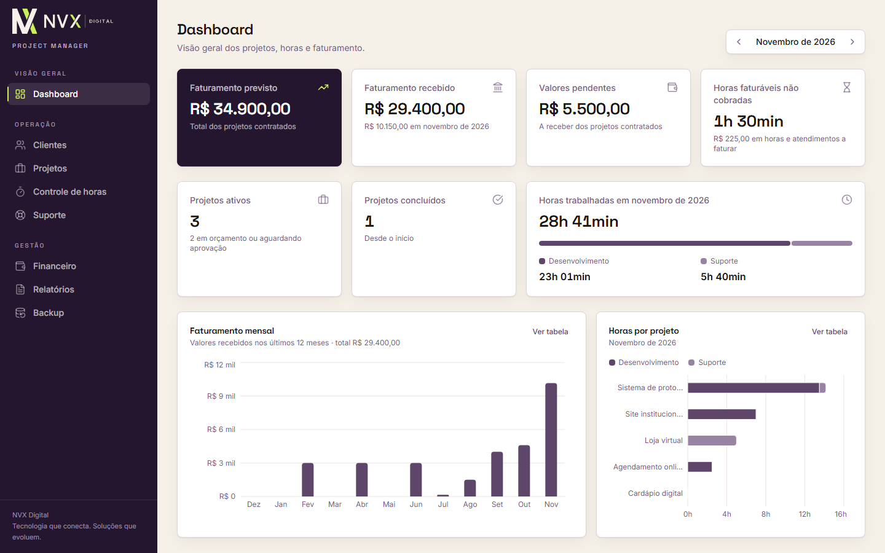
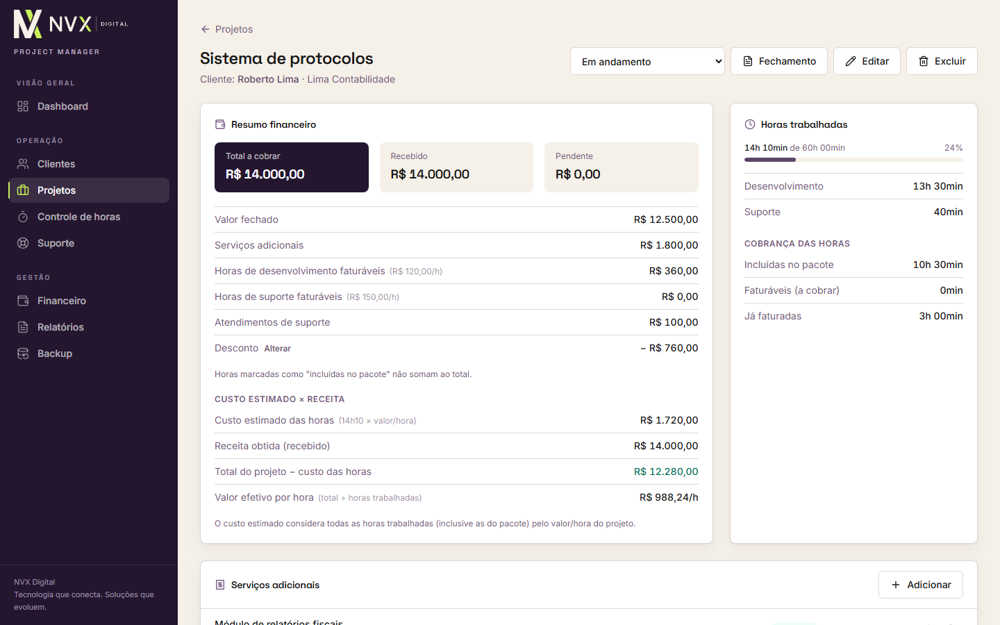
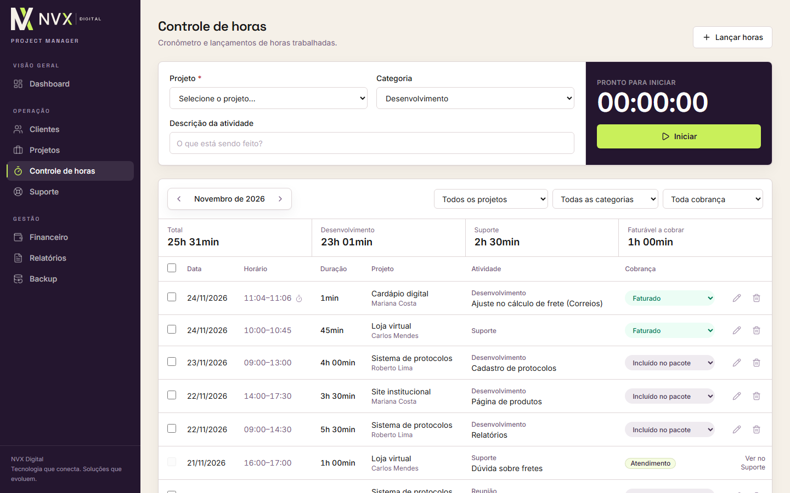
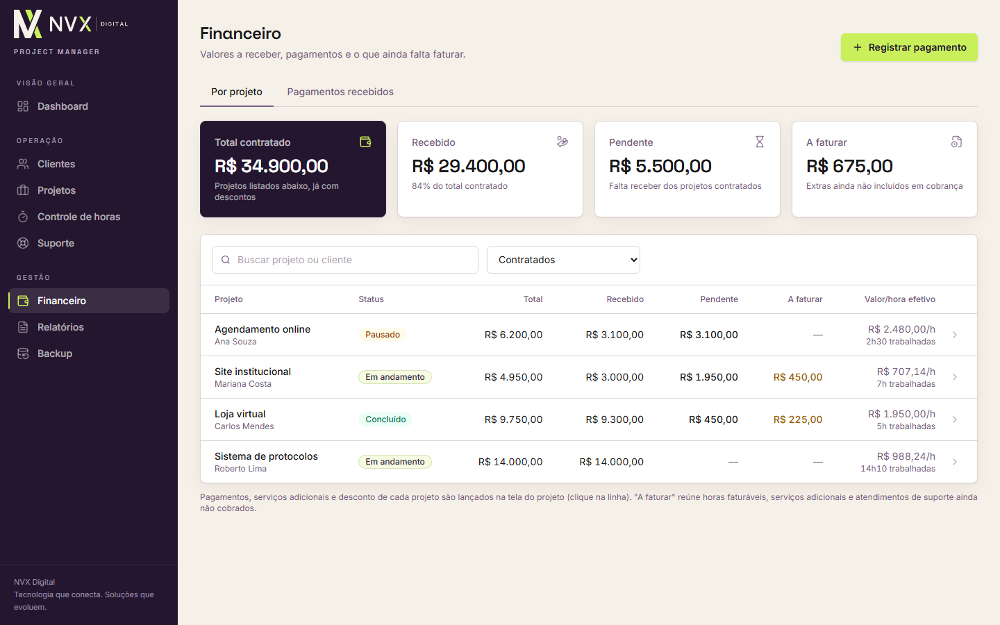
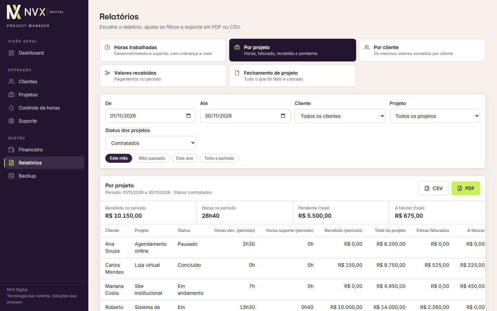

# NVX Project Manager

Aplicativo desktop para Windows que centraliza a gestão de uma pequena empresa de software: **clientes, projetos, horas trabalhadas (com cronômetro), suporte, cobrança, relatórios em PDF/CSV e backup**. Funciona 100% offline, sem servidor, hospedagem ou serviços pagos.

Desenvolvido para uso interno da **NVX Digital**, com a identidade visual oficial da marca.



## Funcionalidades

- **Dashboard:** faturamento previsto, recebido e pendente, horas do mês (desenvolvimento × suporte), horas faturáveis não cobradas e gráficos com versão em tabela.
- **Clientes e projetos:** validação de CPF/CNPJ, telefone e e-mail; bloqueio de duplicidades; status, prazos, estimativa de horas e valores.
- **Controle de horas:**
  - cronômetro que continua certo mesmo com o programa fechado ou o computador desligado;
  - pausas descontadas;
  - lançamento manual com bloqueio de horários sobrepostos;
  - situação de cobrança (incluído no pacote, faturável, faturado).
- **Suporte:**
  - atendimentos com valor sugerido pelo tempo;
  - conversão de horas do cronômetro em atendimento, sem contagem dupla;
  - "pago" gera o pagamento automaticamente.
- **Financeiro:**
  - total do projeto (valor fechado + extras − desconto), recebido, pendente e "a faturar";
  - serviços adicionais;
  - pagamentos com proteção contra duplicidade;
  - custo estimado das horas × receita e valor efetivo por hora.
- **Relatórios:**
  - horas, por projeto, por cliente, recebimentos e fechamento de projeto;
  - exportação em **PDF** (gerado localmente) e **CSV** no padrão das planilhas brasileiras.
- **Backup e lixeira:**
  - backup manual;
  - backups automáticos diários;
  - restauração validada, com cópia de segurança do estado atual antes de restaurar;
  - lixeira que respeita vínculos e duplicidades.

| Projeto | Controle de horas |
|---|---|
|  |  |
| **Financeiro** | **Relatórios** |
|  |  |

## Tecnologias

| Camada | Tecnologia |
|---|---|
| Aplicativo desktop | Electron 45 + instalador NSIS (electron-builder) |
| Interface | React 19, TypeScript, Vite, Tailwind CSS 4, React Router, Recharts |
| API interna | Node.js 24 + Express 5, validação com Zod (mesmos esquemas na interface e na API) |
| Banco de dados | SQLite embutido (`node:sqlite`), migrações versionadas |
| PDF / CSV | jsPDF + jspdf-autotable, gerados no próprio computador |
| Testes | Vitest: 121 testes (regras, rotas, ponta a ponta e volume) |

## Destaques técnicos

- **Arquitetura local segura:** o Electron sobe uma API Express só em `127.0.0.1`, em porta aleatória. A janela usa `contextIsolation` e `sandbox` e só navega no próprio sistema.
- **Cálculos sem erro de arredondamento:** valores em centavos e tempos em segundos. A regra financeira está num único módulo (`shared/financeiro.ts`), usado pelo dashboard, pelos projetos, pelo financeiro e pelos relatórios. Um teste de ponta a ponta confere que todos mostram os mesmos números.
- **Integridade dos dados:**
  - tabelas `STRICT`, chaves estrangeiras e índices únicos parciais;
  - exclusão lógica (lixeira);
  - transações nas operações compostas;
  - restauração de backup atômica (`ATTACH` + transação + `foreign_key_check`).
- **Cronômetro à prova de falhas:** o tempo é sempre recalculado a partir dos horários salvos no banco, nunca de um contador em memória.
- **Desempenho:** com 15 mil lançamentos, dashboard, financeiro e relatórios respondem em menos de 70 ms.
- **Acessibilidade:** foco visível, navegação por teclado, modais acessíveis, gráficos com tabela alternativa e paleta validada para daltonismo.
- **Interface 100% em português**, com moeda (R$) e datas no padrão brasileiro.

## Como executar (desenvolvimento)

Requer [Node.js](https://nodejs.org) 22.13 ou superior (testado com 24).

```powershell
npm install
```

```powershell
npm run dados-exemplo
```

```powershell
npm run dev
```

Abra http://127.0.0.1:5173. O comando `dados-exemplo` é opcional: preenche o banco de desenvolvimento com dados fictícios.

| Comando | O que faz |
|---|---|
| `npm run dev` | Interface com recarga automática (API em 127.0.0.1:3000, banco em `data/nvx.db`) |
| `npm run app` | Compila e abre o aplicativo desktop sem instalar |
| `npm run instalador` | Gera o instalador Windows em `instalador\` |
| `npm test` | Testes automatizados |
| `npm run typecheck` | Verificação de tipos TypeScript |

## Instalar o aplicativo

1. Gere o instalador com `npm run instalador`. Ele cria `instalador\NVX-Project-Manager-Setup-<versão>.exe`.
2. Execute o arquivo em qualquer Windows 10/11 de 64 bits e siga o assistente.
3. Na primeira execução, o Windows pode mostrar "O Windows protegeu o computador" (o instalador não tem certificado digital pago). Clique em **Mais informações → Executar assim mesmo**.

Os dados ficam em `%APPDATA%\NVX Project Manager\dados` (menu **Arquivo → Abrir pasta dos dados**). Desinstalar ou atualizar não apaga nada. Os backups automáticos ficam na subpasta `backups`.

Guia completo de uso: [docs/manual-de-uso.md](docs/manual-de-uso.md)

## Estrutura

```
electron/   processo principal (janela, menu, downloads)
server/     API interna, banco SQLite, migrações e testes
src/        interface React (páginas, componentes, tema)
shared/     regras e formatação usadas pela interface e pela API
scripts/    utilitários (dados de exemplo)
docs/       requisitos, arquitetura, manual de uso e imagens
```

Documentação técnica: [requisitos e critérios de aceite](docs/requirements.md) · [arquitetura e API](docs/architecture.md)

## Identidade visual

Segue o **Manual de Identidade Visual NVX Digital** (v1.0, 2026):

- **Cores e fontes:**
  - tokens em `src/index.css` (bloco `@theme`);
  - Roxo Profundo no menu, Areia no fundo, Lima no botão principal e no foco, Lavanda nos textos secundários;
  - títulos e números de destaque em Space Grotesk (licença OFL), texto em Inter.
- **Logotipo e ícones:** arquivos oficiais, sem redesenho. Estão em `src/assets/marca/`, `public/favicon.svg` e `build/icon.png`.

## Licença

© 2026 NVX Digital. Todos os direitos reservados. O código está público apenas para consulta (portfólio). Veja [LICENSE](LICENSE).
A marca, o logotipo e a identidade visual NVX Digital não podem ser usados sem autorização. As fontes Inter e Space Grotesk são distribuídas sob a SIL Open Font License.
